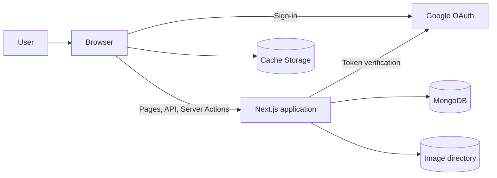
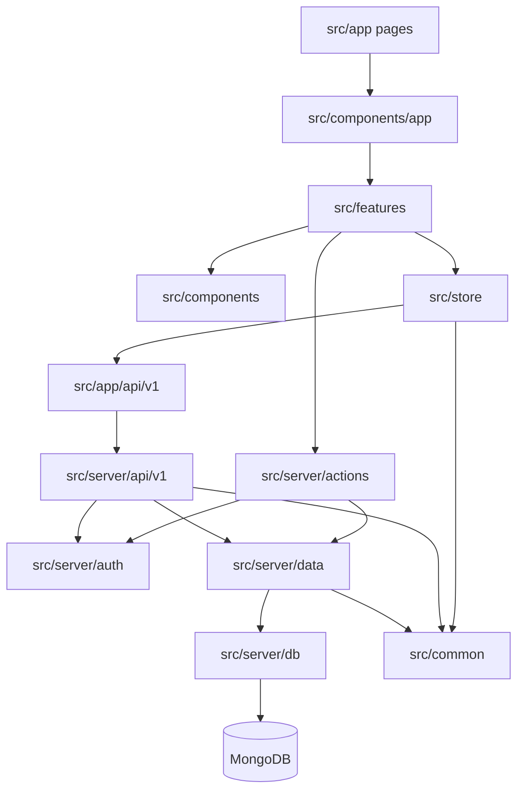
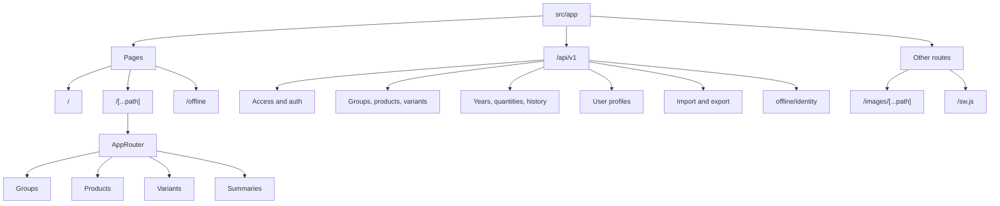

# RUSYS architecture and structure

This guide covers the system boundary, main technologies, source layout, and application routes.
[Project README](../README.md).

## Purpose

RUSYS manages groups, products, their variants, quantities, and change history. It also provides reviews, summaries,
user profiles, import and export, Google sign-in, and PWA support for viewing previously cached data offline.

## Technology stack

| Area                     | Technology                                    |
| ------------------------ | --------------------------------------------- |
| Web framework            | Next.js 16 App Router, React 19, TypeScript   |
| Client state             | Redux Toolkit                                 |
| UI                       | Mantine, CSS                                  |
| Database                 | MongoDB and the MongoDB Node.js driver        |
| Authentication           | Google OAuth and a server-side session cookie |
| Unit and component tests | Vitest, Testing Library, jsdom                |
| Browser tests            | Playwright, Chromium, WebKit                  |
| Static checks            | Prettier, TypeScript, ESLint, Stylelint       |
| Runtime and deployment   | pnpm, Docker, Docker Compose, Nginx           |

Dependencies and scripts are defined in [package.json](../package.json). Framework behavior is configured in
[next.config.ts](../next.config.ts), and browser tests in [playwright.config.ts](../playwright.config.ts).

## System context



MongoDB stores application data, while uploaded images are kept in a configurable directory. A production Service Worker
caches selected responses in the browser for offline viewing.

## Repository layout

```text
.
├── .github/workflows/       GitHub Actions CI
├── docker/                  Docker image, Compose, and Nginx configuration
├── docs/                    Project documentation
├── public/                  Public files, PWA icons, and manifest
├── scripts/                 Asset generation and deployment scripts
└── src/
    ├── app/                 Next.js pages, API routes, and PWA routes
    ├── common/              Shared types, API paths, and pure functions
    ├── components/          Reusable UI components
    ├── features/            Feature-specific pages, components, and hooks
    ├── lib/                 Localization and client utilities
    ├── server/              Database, authentication, data, API, and actions
    ├── store/               Redux store, slices, and request hooks
    └── tests/               Test setup and Playwright helpers
```

The `features` directory contains groups, products, variants, summaries, reviews, filters, and dialogs. `components`
holds shared UI such as tables, quantity displays, toolbars, and the application shell. Redux slices in `store` cover
groups, products, variants, years, summaries, profiles, Google state, and errors. `common` is safe to import from both
client and server code; `server` contains Node.js-only code.

The public facade for product data operations is `src/server/data/products.ts`. Its implementation is split into read,
stock, image, and mutation modules.

## Module dependencies



This diagram shows typical dependency paths. Server-rendered pages also load initial application data before sending the
page to the browser.

## Pages and API routes



`src/components/app/AppRouter.tsx` selects a client page using paths from `src/lib/links.ts`. REST route files live
under `src/app/api/v1`; client URL builders are defined in `src/common/api/v1.ts`. Server Actions live in
`src/server/actions`.
