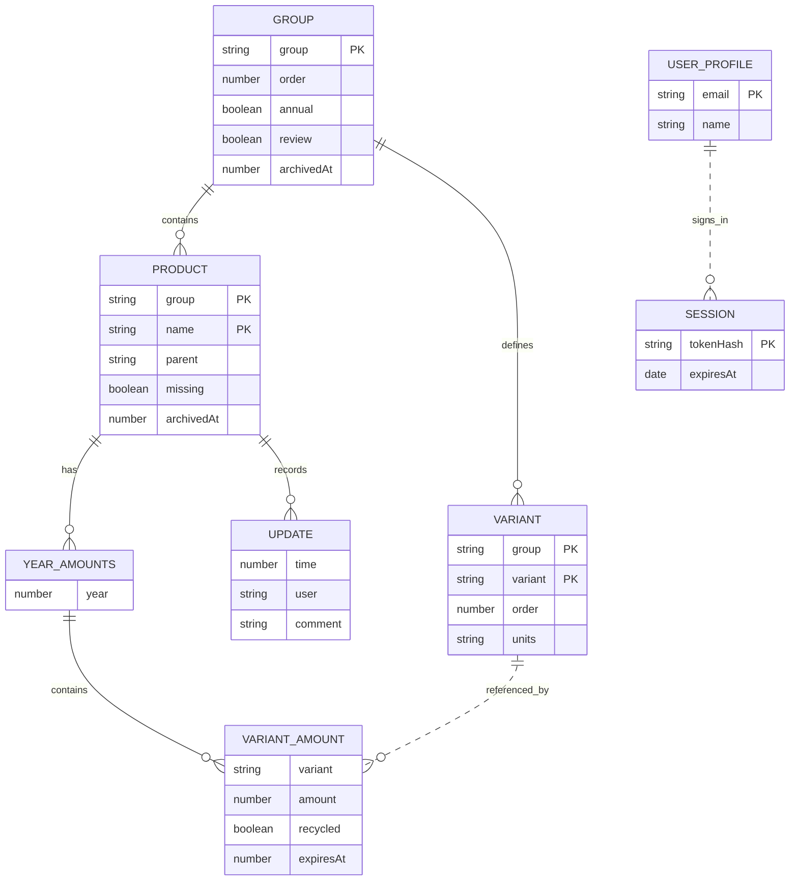
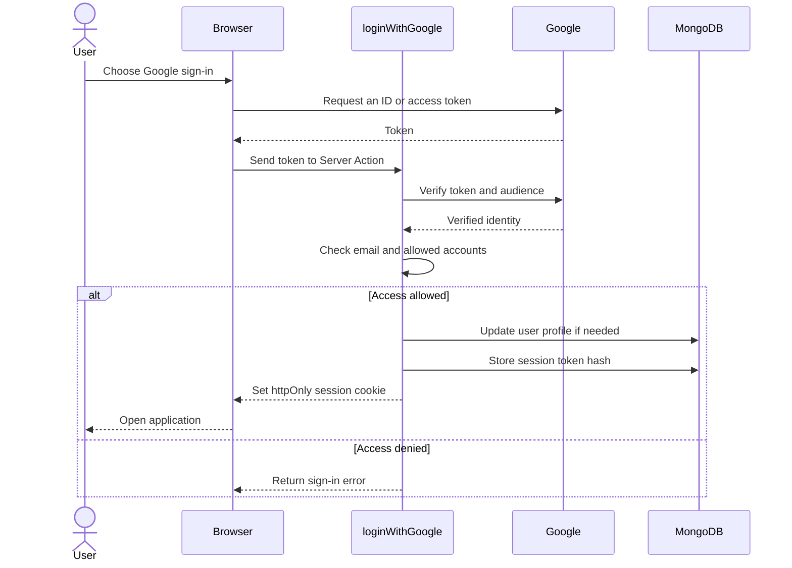
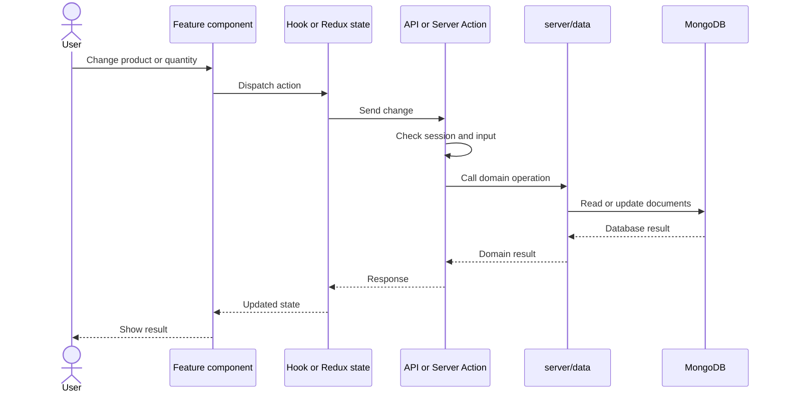
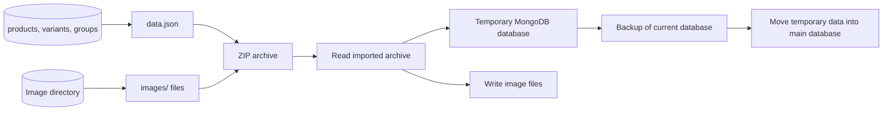
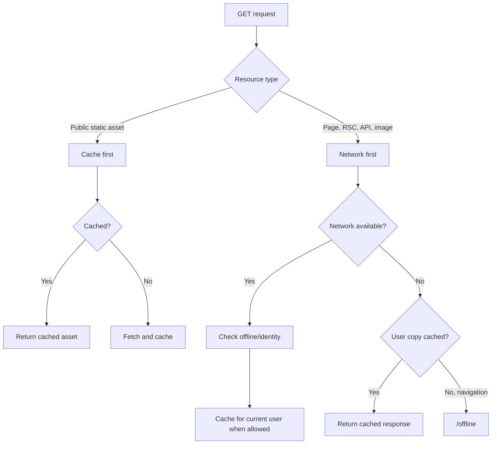

# RUSYS data and workflows

This guide covers the data model, authentication, application updates, import and export, and offline caching.
[Project README](../README.md).

## Data and security

`src/server/db.ts` manages MongoDB connections and creates missing indexes when a database is first opened. The main
collections are:

| Collection      | Purpose                                         |
| --------------- | ----------------------------------------------- |
| `groups`        | Groups, display order, and archive status       |
| `products`      | Products, yearly quantities, and change history |
| `variants`      | Group variants and their display order          |
| `user_profiles` | User profiles                                   |
| `sessions`      | Hashed session tokens and expiry times          |

Some stock changes use MongoDB transactions. The session token is stored in an `httpOnly` cookie; MongoDB stores its
SHA-256 hash. Access is limited to configured Google accounts. Development mode uses a development profile.

Configuration is passed through environment variables. Docker Compose uses `LOCALE`, `TZ`, `GOOGLE_CLIENT_ID`,
`GOOGLE_ALLOWED_USERS`, `DB`, optional `IMAGES_DIR`, and `PORT`. The database code also accepts `DB_NAME`. Local
development reads `.env.local`.

### MongoDB document model

`YEAR_AMOUNTS`, `VARIANT_AMOUNT`, and `UPDATE` are embedded in product documents; they are not separate collections.
Dotted relationships are logical links, not MongoDB foreign keys. Full types are defined in `src/common/data.ts`.

### Sign-in sequence

This follows `src/server/actions/auth.ts` and `src/server/auth/session.ts`. Protected REST requests pass through the
session check in `src/server/api/next.ts`.

## Requests and updates

The UI calls a hook or updates client state, then sends a request through a REST endpoint or Server Action. The server
checks the session and input before calling the data layer.

REST route files are in `src/app/api/v1/**/route.ts`, with handlers in `src/server/api/v1`. Shared API paths are defined
in `src/common/api/v1.ts`. Product data operations are exposed through `src/server/data/products.ts`.

## Import and export

`src/server/data/exportArchive.ts` defines the ZIP structure. `src/server/data/common.ts` moves collections through
temporary and backup databases during import.

## PWA and offline viewing

The application includes `public/manifest.json`, generated PWA images, an offline page, and a Service Worker route.
`pnpm assets` generates icons, splash screens, metadata, and optimized images. Registration and account-specific cache
logic are in `src/components/app/ServiceWorker`.

Previously cached responses can be viewed offline. Signing out or changing accounts clears the former user's cache.
Offline editing and later synchronization are not implemented. See the
[Service Worker guide](../src/components/app/ServiceWorker/README.md) for details.
