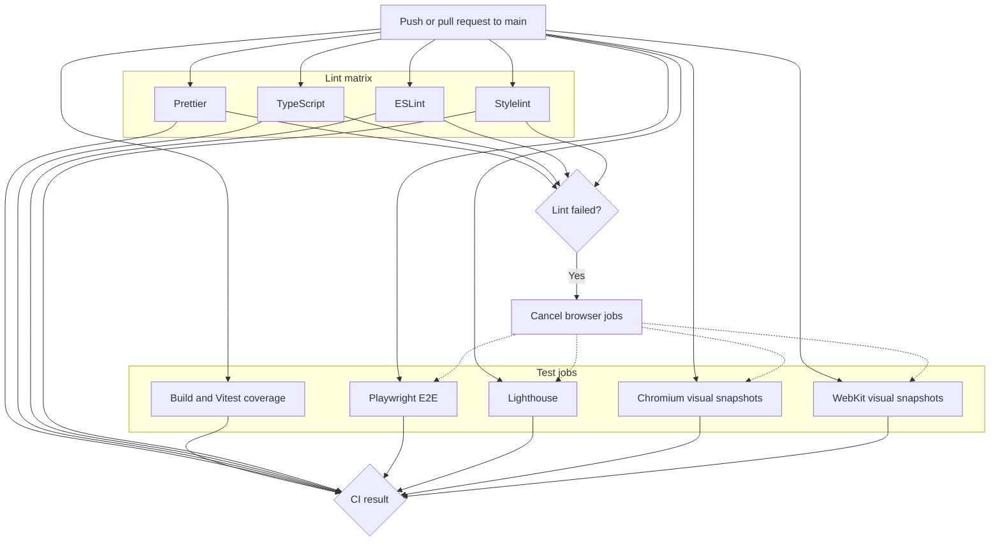
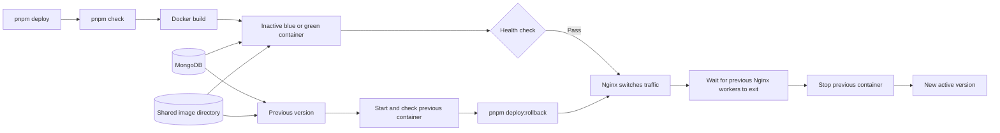

# RUSYS development and deployment

This guide covers local setup, checks, CI, and production deployment. [Project README](../README.md).

## Local development

The package requires Node.js 24 or newer and specifies `pnpm@11.24.0`.

```sh
pnpm install
pnpm config
pnpm dev
```

The development server runs at `http://localhost:3021`. Local configuration is read from `.env.local`; keep credentials
out of Git.

| Command              | Purpose                                    |
| -------------------- | ------------------------------------------ |
| `pnpm config`        | Configure the repository's Git hooks       |
| `pnpm dev`           | Start the Next.js development server       |
| `pnpm build`         | Build the production application           |
| `pnpm start`         | Run a production build                     |
| `pnpm format`        | Format files with Prettier                 |
| `pnpm format:check`  | Check formatting                           |
| `pnpm lint:ts`       | Run TypeScript checks                      |
| `pnpm lint:es`       | Run ESLint                                 |
| `pnpm lint:styles`   | Run Stylelint on CSS                       |
| `pnpm lint`          | Run all four static checks sequentially    |
| `pnpm test`          | Run Vitest                                 |
| `pnpm test:coverage` | Run Vitest with coverage                   |
| `pnpm test:e2e`      | Run Playwright `*.spec.ts` tests           |
| `pnpm test:a11y`     | Run Playwright axe accessibility scans     |
| `pnpm test:visual`   | Run Vitest Browser Mode `*.snap.tsx` tests |
| `pnpm check`         | Run lint and unit tests                    |
| `pnpm check:all`     | Run lint, coverage, visual, and E2E tests  |
| `pnpm assets`        | Generate and optimize PWA assets           |

The four Noto families are loaded through `next/font/google` in `src/app/layout.tsx`. A production build downloads and
self-hosts them as hashed `/_next/static/` assets, so the build needs access to Google Fonts. Browsers request all fonts
from this app. Next.js supplies immutable cache headers, and the service worker caches requested static assets for later
offline use.

Browser tests require installed browsers. E2E tests use a temporary MongoDB instance and one worker so database resets
cannot overlap. Visual tests use scenario fixtures instead of MongoDB and mount the app in Vitest Browser Mode. The
Playwright provider supplies Chromium and WebKit; configuration lives in `playwright.config.ts` for E2E and
`vitest.visual.config.mts` for visual tests. Unit and server tests use `vitest.config.mts`. Accessibility scans are
Playwright tests colocated with their feature; they share the axe assertion in `src/tests/playwright/accessibility.ts`
and run through `pnpm test:a11y`.

Run `pnpm config` after installing dependencies to enable the repository's Git hooks. The pre-commit hook runs Gitleaks
on staged changes, followed by `pnpm lint`. Prettier, ESLint, and Stylelint cache results for unchanged files;
TypeScript stores incremental project information. Their local cache files are ignored by Git. The first run still
checks the full project, while later runs reuse cached results where possible.

## Continuous integration

The workflow in `.github/workflows/ci.yml` runs on pushes and pull requests targeting `main`. Its `lint` matrix runs
formatting, TypeScript, ESLint, and Stylelint concurrently as individually named jobs. The test group contains build and
Vitest coverage, Playwright E2E, Lighthouse accessibility, and Chromium/WebKit visual snapshots. Each test job depends
on available runners and starts alongside lint. If a lint check fails, the lint matrix cancels its remaining checks and
four cancellation jobs stop any running or queued browser jobs. Build and coverage continue independently so their
results remain visible. A failure in any lint or test job fails the workflow.



The browser jobs each use a unique concurrency group for this workflow run. After a lint failure, the cancellation
matrix enters those same groups and cancels active or pending browser jobs. It also publishes a failure marker so a
browser job admitted later stops before checkout or browser setup. To add another lint check, add one entry to
`jobs.lint.strategy.matrix.check`; no test dependencies need updating. The lint matrix uses `fail-fast: true` to start
cancellation promptly after the first failure, so some other lint checks may be canceled before they finish. The
[accessibility guide](../ACCESSIBILITY.md) covers JSX rules, component axe tests, Playwright scans, and Lighthouse CI.

## Deployment and rollback

The production image is built from [docker/Dockerfile](../docker/Dockerfile).
[docker/compose.yaml](../docker/compose.yaml) defines a MongoDB replica set, blue and green application containers, an
Nginx gateway, and an Alloy monitoring service. Both application containers share the MongoDB service and image
directory.



`pnpm deploy` runs `pnpm check`, builds the inactive container, waits for its health check, and switches Nginx traffic.
After the reload, it waits up to six minutes for the previous Nginx worker processes to exit, then stops the previous
application container. If the workers do not exit or their status cannot be checked, deployment reports a failure and
leaves the previous container running. Deployment requires a running `rusys-gateway`.

The deployment uploads [monitoring configuration](../docker/monitoring/config.alloy), validates Compose and Alloy
configuration, and recreates `monitoring` (Grafana Alloy) before building the new application slot. Alloy collects
Docker container metrics with cAdvisor and NAS host metrics with the Unix exporter every 15 seconds. It sends both to
Grafana Cloud using Prometheus remote write, with `project=rusys`, `environment=production`, and `host=synology-ds923`
labels. It also discovers this Compose project's Docker logs, sanitizes them, and writes structured entries to Grafana
Cloud Loki. The [Docker logging guide](monitoring/DOCKER-LOGGING.md) describes privacy filtering and Explore
verification. It uses host networking so Unix network metrics reflect the NAS, and binds its local status UI only to
`127.0.0.1:12345` on the NAS. Its write-ahead log uses a persistent Docker volume across recreations.

Set these values in the server's `.env` before deploying; Compose refuses to start if any is empty:

| Name               | Value                                                                 |
| ------------------ | --------------------------------------------------------------------- |
| `GC_METRICS_URL`   | Grafana Cloud Prometheus remote write URL                             |
| `GC_METRICS_USER`  | Grafana Cloud Prometheus username or instance ID                      |
| `GC_METRICS_TOKEN` | Grafana Cloud token with metrics write permission                     |
| `GC_LOKI_URL`      | Grafana Cloud Loki push endpoint ending in `/loki/api/v1/push`        |
| `GC_LOKI_USER`     | Grafana Cloud logs instance ID                                        |
| `GC_LOKI_TOKEN`    | Grafana Cloud token with `logs:write` permission                      |
| `DOCKER_ROOT_DIR`  | NAS Docker data root from `docker info --format '{{.DockerRootDir}}'` |

Alloy's cAdvisor exporter requires privileged mode and host filesystem mounts according to the
[Grafana Alloy Docker guidance](https://grafana.com/docs/alloy/latest/reference/components/prometheus/prometheus.exporter.cadvisor/).
The service mounts the Docker socket, host root, `/proc`, `/sys`, `/var/run` read-only, and the Docker data root.
Synology may not have `/dev/disk`, so this path is not mounted; cAdvisor disk and container filesystem I/O metrics may
be incomplete. The Docker socket and privileged mode grant broad host access even with read-only mounts. Keep the server
and Grafana Cloud token restricted. Verify that `DOCKER_ROOT_DIR` matches the NAS value before deployment, since
Synology installations may not use `/var/lib/docker`. The configured directory must exist, or Docker may create an empty
bind mount and container metrics will be incomplete.

After deployment, check Grafana Cloud Explore for `up{project="rusys",environment="production",host="synology-ds923"}`
and confirm both scrape jobs report `1`. Check `node_network_receive_bytes_total` for NAS interfaces and
`container_cpu_usage_seconds_total` and `container_memory_working_set_bytes` for containers. Confirm host CPU/RAM and
container CPU/RAM series first, then inspect which disk and filesystem I/O series are available. A running Alloy
container confirms startup only; it does not confirm successful scraping or Cloud authentication. If metrics are absent,
inspect `docker logs rusys-monitoring` on the NAS and the loopback Alloy status UI through an SSH tunnel.

The public site and `/api/health` are also monitored by Grafana Cloud's external Frankfurt probe. Their checks,
alerting, dashboard, and separate local Grafana credential keys are documented in the
[Synthetic Monitoring guide](monitoring/SYNTHETIC-MONITORING.md). Those external checks do not depend on Alloy.

`pnpm deploy:rollback` requires a healthy previous container. After a successful deployment, start the stopped previous
container on the server and wait for it to become healthy before running rollback. The previous image remains available,
so this does not require a rebuild.

### Automatic production releases

The [CI workflow](../.github/workflows/ci.yml) runs the full suite once for each push to `main`, including a pull
request merge. Only after lint, build, coverage, E2E, Lighthouse, and visual tests all pass does it compare the project
version before and after the push. A version change starts the production deployment job; an unchanged version or failed
check does not. Pull requests run the same checks without version detection or deployment. The package's `version`
script also updates Docker's `APP_VERSION` build label in `docker/compose.yaml`.

The production job checks out the pushed commit, configures SSH, and runs `pnpm deploy:run`. The deployment script
reports failure if upload, Docker build, health checks, or the gateway switch fails. It checks required Docker build
sources before connecting and creates an empty `scripts/postcss` directory if the checkout omits it, so Docker can still
copy that path. Production deployments are serialized.

Create a GitHub Actions environment named `production` in the repository settings. Restrict its deployment branches to
`main`. Add these environment settings:

| Name                     | Type     | Value                                                           |
| ------------------------ | -------- | --------------------------------------------------------------- |
| `DEPLOY_SSH_PRIVATE_KEY` | Secret   | Private SSH key for the deployment user                         |
| `DEPLOY_SSH_KNOWN_HOSTS` | Secret   | Verified SSH host key entry for the server                      |
| `DEPLOY_USER`            | Variable | SSH user                                                        |
| `DEPLOY_HOST`            | Variable | SSH host                                                        |
| `DEPLOY_PORT`            | Variable | SSH port; optional, defaults to `22`                            |
| `DEPLOY_PATH`            | Variable | Existing application directory on the server                    |
| `DOCKER_PATH`            | Variable | Docker executable on the server; optional, defaults to `docker` |

The SSH user needs access to the application directory and Docker on the server. The server keeps its own `.env` for
Compose; do not upload it or add it to Git. Verify the host key out of band before saving `DEPLOY_SSH_KNOWN_HOSTS`;
include `[host]:port` for a nonstandard SSH port. Environment secrets become available only to the deployment job.
Required reviewers can be added when releases need a manual approval, but leave them unset for fully automatic
deployment.

## When changing the project

- Put types and pure functions shared by client and server in `src/common`; keep MongoDB access and secrets in
  `src/server`.
- Group feature-specific UI under `src/features` and reusable UI under `src/components`.
- For a new REST endpoint, add its App Router `route.ts`, server handler, shared API path, and relevant tests.
- Add new pages to the Playwright accessibility route list and Lighthouse URL configuration.
- Update the relevant documentation section when architecture, commands, or deployment behavior changes.
