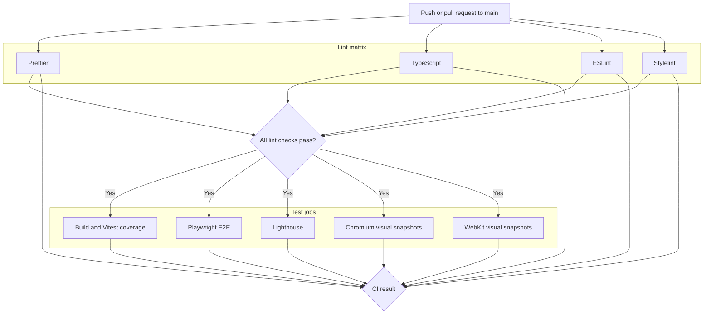
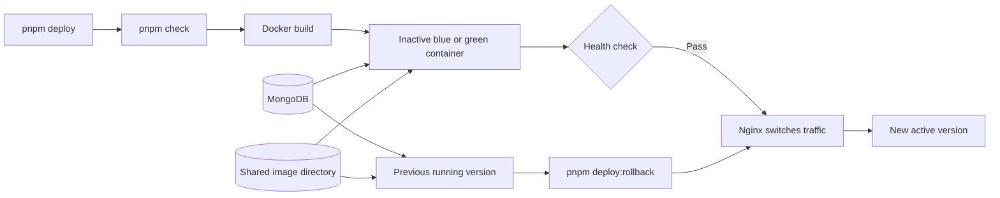

# RUSYS development and deployment

This guide covers local setup, checks, CI, and production deployment. [Project README](../README.md).

## Local development

The package requires Node.js 24 or newer and specifies `pnpm@11.24.0`.

```sh
pnpm install
pnpm dev
```

The development server runs at `http://localhost:3021`. Local configuration is read from `.env.local`; keep credentials
out of Git.

| Command              | Purpose                                   |
| -------------------- | ----------------------------------------- |
| `pnpm dev`           | Start the Next.js development server      |
| `pnpm build`         | Build the production application          |
| `pnpm start`         | Run a production build                    |
| `pnpm format`        | Format files with Prettier                |
| `pnpm format:check`  | Check formatting                          |
| `pnpm lint:ts`       | Run TypeScript checks                     |
| `pnpm lint:es`       | Run ESLint                                |
| `pnpm lint:styles`   | Run Stylelint on CSS                      |
| `pnpm lint`          | Run all four static checks sequentially   |
| `pnpm test`          | Run Vitest                                |
| `pnpm test:coverage` | Run Vitest with coverage                  |
| `pnpm test:e2e`      | Run Playwright `*.spec.ts` tests          |
| `pnpm test:visual`   | Run Playwright `*.snap.ts` tests          |
| `pnpm check`         | Run lint and unit tests                   |
| `pnpm check:all`     | Run lint, coverage, visual, and E2E tests |
| `pnpm assets`        | Generate and optimize PWA assets          |

Playwright tests require installed browsers. E2E tests use a temporary MongoDB instance. Visual tests start a separate
Next.js server. Configuration lives in `vitest.config.mts` and `playwright.config.ts`.

## Continuous integration

The workflow in `.github/workflows/ci.yml` runs on pushes and pull requests targeting `main`. Its `lint` matrix runs
formatting, TypeScript, ESLint, and Stylelint concurrently as individually named jobs. The test group contains build and
Vitest coverage, Playwright E2E, Lighthouse accessibility, and Chromium/WebKit visual snapshots. Each test job depends
only on `lint`, so the test group starts after every lint matrix job passes and can run concurrently when runners are
available. A failure in any lint or test job fails the workflow.



The build and coverage, Playwright, and Lighthouse jobs use `needs: lint`. To add another lint check, add one entry to
`jobs.lint.strategy.matrix.check`; no test dependencies need updating. The lint matrix uses `fail-fast: false`, so all
lint results remain visible even if one fails. GitHub Actions skips the test jobs when any lint check fails. The
[accessibility guide](../ACCESSIBILITY.md) covers JSX rules, component axe tests, Playwright scans, and Lighthouse CI.

## Deployment and rollback

The production image is built from [docker/Dockerfile](../docker/Dockerfile).
[docker/compose.yaml](../docker/compose.yaml) defines a MongoDB replica set, blue and green application containers, and
an Nginx gateway. Both application containers share the MongoDB service and image directory.



`pnpm deploy` runs `pnpm check`, builds the inactive container, waits for its health check, and switches Nginx traffic.
The previous container remains running. `pnpm deploy:rollback` returns traffic to that healthy container without
rebuilding. Deployment requires a running `rusys-gateway`; rollback also requires a healthy previous container.

## When changing the project

- Put types and pure functions shared by client and server in `src/common`; keep MongoDB access and secrets in
  `src/server`.
- Group feature-specific UI under `src/features` and reusable UI under `src/components`.
- For a new REST endpoint, add its App Router `route.ts`, server handler, shared API path, and relevant tests.
- Add new pages to the Playwright accessibility route list and Lighthouse URL configuration.
- Update the relevant documentation section when architecture, commands, or deployment behavior changes.
