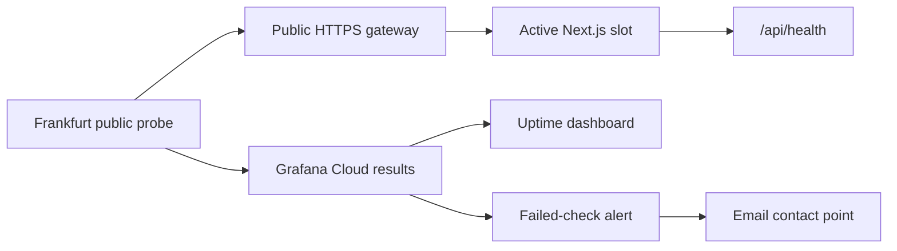

# Grafana Cloud Synthetic Monitoring

This guide describes the deployed external uptime checks for RUSYS, their alert routing, and how to recreate or verify
the configuration. The [monitoring overview](MONITORING.md) links to the current Alloy setup and the historical roadmap
for other proposed monitoring work.

## Current setup

| Resource                     | Configuration                                                                                                   |
| ---------------------------- | --------------------------------------------------------------------------------------------------------------- |
| Grafana Cloud stack          | [purplecheetah2525.grafana.net](https://purplecheetah2525.grafana.net/)                                         |
| Public site                  | `https://rusys.andriaus.com/`                                                                                   |
| Liveness endpoint            | `https://rusys.andriaus.com/api/health`                                                                         |
| Synthetic Monitoring backend | `synthetic-monitoring-api-eu-west-2.grafana.net`                                                                |
| Public probe                 | Frankfurt, one probe per check                                                                                  |
| Check interval and timeout   | Five minutes and ten seconds                                                                                    |
| Alert destination            | `Rusys uptime email` contact point (`danikas2k2@gmail.com`)                                                     |
| Dashboard                    | [Rusys synthetic uptime](https://purplecheetah2525.grafana.net/d/rusys-synthetic-uptime/rusys-synthetic-uptime) |

The public Grafana probe calls RUSYS through its normal HTTPS address. It sends results to Grafana Cloud, where the
dashboard and alert rule read them. The probe, liveness endpoint, and alert delivery do not require the NAS Alloy
container to be running. Alloy has a separate role: collecting NAS and Docker metrics.



## Local setup credentials

Create `.env.grafana.local` at the repository root for Grafana configuration work. It is ignored by Git through the
`.env.*.local` rule. Use the following keys; replace the example secrets with their full token **values**, not token
names or IDs:

```dotenv
GRAFANA_URL=https://purplecheetah2525.grafana.net/
ALERT_EMAIL=danikas2k2@gmail.com
SM_BACKEND_URL=synthetic-monitoring-api-eu-west-2.grafana.net
SM_ACCESS_TOKEN=replace-with-synthetic-monitoring-access-token
GRAFANA_SERVICE_ACCOUNT_TOKEN=replace-with-grafana-service-account-token
```

| Key                             | Where to obtain it                                                                        | Use                                                                                                                                                                |
| ------------------------------- | ----------------------------------------------------------------------------------------- | ------------------------------------------------------------------------------------------------------------------------------------------------------------------ |
| `GRAFANA_URL`                   | Grafana Cloud stack address                                                               | Grafana dashboard and alerting API base URL.                                                                                                                       |
| `ALERT_EMAIL`                   | Chosen notification mailbox                                                               | Address to enter in the email contact point.                                                                                                                       |
| `SM_BACKEND_URL`                | **Testing & synthetics → Synthetics → Config → General**, under “Your backend address is” | Synthetic Monitoring API base address. It is different from `GRAFANA_URL`.                                                                                         |
| `SM_ACCESS_TOKEN`               | **Testing & synthetics → Synthetics → Config → Access tokens → Generate access token**    | Bearer token for Synthetic Monitoring checks and probes. Copy the newly shown complete value.                                                                      |
| `GRAFANA_SERVICE_ACCOUNT_TOKEN` | **Administration → Users and access → Service accounts → Add service account token**      | Bearer token for Grafana dashboards, contact points, notification policies, and read-only verification. The service account needs permissions for those resources. |

The two tokens authenticate to different APIs and are not interchangeable. Keep this file local, never commit it, and do
not copy these tokens into `.env.local`, the server's Compose `.env`, or browser-facing `NEXT_PUBLIC_*` variables. The
application and its deployment commands do not automatically load `.env.grafana.local`: it is a local reference for
Grafana UI or API administration. Once configured, the checks run in Grafana Cloud without this file or either token on
the production server. See the
[Synthetic Monitoring API authentication guide](https://grafana.com/docs/grafana-cloud/observe-and-act/testing/synthetic-monitoring/api-reference/)
and [Grafana service account guide](https://grafana.com/docs/grafana/latest/administration/service-accounts/).

## Deploy the liveness endpoint

The implementation is [src/app/api/health/route.ts](../src/app/api/health/route.ts). `GET /api/health` returns HTTP 200
with `{"status":"ok"}` and `Cache-Control: no-store`. It is deliberately a **liveness** check: it does not query MongoDB
or Alloy. The external health check verifies both the body and the cache header so an unrelated 200 response cannot
silently pass.

From the repository root, deploy application changes with the existing deployment setup:

```sh
pnpm install
pnpm check
pnpm deploy:run
curl -si https://rusys.andriaus.com/api/health
```

`pnpm deploy:run` reads `.env.deploy.local`, builds the inactive blue/green slot, checks it, and switches the public
gateway. `pnpm deploy` includes `pnpm check` before that deployment. Follow the
[deployment guide](DEVELOPMENT-AND-DEPLOYMENT.md) for the server and CI setup. The expected public health response is
HTTP 200, JSON `{"status":"ok"}`, and a `Cache-Control` header containing `no-store`. The homepage currently returns
HTTP 200 to anonymous visitors; if its intended behavior changes to a redirect, update its expected status in the
Synthetic Monitoring check.

The existing SSH deployment needs `DEPLOY_USER`, `DEPLOY_HOST`, and `DEPLOY_PATH` in `.env.deploy.local`. It also
accepts optional `DEPLOY_PORT` (default `22`) and `DOCKER_PATH` (default `docker`). These keys are separate from the
five Grafana keys above. SSH authentication and the server's own Compose `.env` must already be configured as described
in the deployment guide; Synthetic Monitoring adds no production-server environment variables.

## Create the external HTTP checks

Open **Testing & synthetics → Synthetics** in the [Grafana stack](https://purplecheetah2525.grafana.net/). Initialize
Synthetic Monitoring if Grafana prompts for it. Create two **API Endpoint → HTTP** checks with these values:

| Setting              | Homepage check                            | Health check                              |
| -------------------- | ----------------------------------------- | ----------------------------------------- |
| Job name             | `rusys-homepage`                          | `rusys-health`                            |
| URL                  | `https://rusys.andriaus.com/`             | `https://rusys.andriaus.com/api/health`   |
| Method               | `GET`                                     | `GET`                                     |
| Expected HTTP status | `200`                                     | `200`                                     |
| Schedule             | Every five minutes                        | Every five minutes                        |
| Timeout              | Ten seconds                               | Ten seconds                               |
| Probe                | Public `Frankfurt`                        | Public `Frankfurt`                        |
| Labels               | `project=rusys`, `environment=production` | `project=rusys`, `environment=production` |

For the health check, also require the response body to match `^\{"status":"ok"\}$` and the `Cache-Control` header to
exist and match `(?i)no-store`. Save and enable both checks. The HTTP check options and public probe model are described
in the
[Grafana HTTP check guide](https://grafana.com/docs/grafana-cloud/observe-and-act/testing/synthetic-monitoring/create-checks/checks/http/).

Under each check's **Alerts**, enable the failed-executions per-check alert with a threshold of **3 failures** in **15
minutes**. Grafana names the shared rule `ProbeFailedExecutionsTooHigh [15m]`. This setting counts failed executions
within a time window; it is not a separate strict-consecutive-failures operator. With one probe at a five-minute
interval, three failures normally represent three failed runs in a row. See the
[per-check alert documentation](https://grafana.com/docs/grafana-cloud/observe-and-act/testing/synthetic-monitoring/configure-alerts/configure-per-check-alerts/).

## Route alerts to email

Under **Alerts & IRM → Alerting → Notification configuration → Contact points**, create an **Email** contact point named
`Rusys uptime email` for `ALERT_EMAIL`. The current contact point UID is `rusys-uptime-email`. Use its **Test** action
to confirm that Grafana accepts a test notification.

Under **Notification policies**, add a child route with both label matchers:

| Label       | Operator | Value                  |
| ----------- | -------- | ---------------------- |
| `namespace` | `=`      | `synthetic_monitoring` |
| `job`       | `=~`     | `rusys-.*`             |

Set its contact point to `Rusys uptime email` and group by `job` and `instance`. The `job` matcher covers both
production checks and a temporary `rusys-alert-test` check. Leave unrelated notification routes unchanged. The per-check
rule creates alert instances with these labels when a check fails; a contact-point test alone does not prove that an
actual check failure routes correctly.

## Import the uptime dashboard

In Grafana, choose **Dashboards → New → Import**, upload
[docker/monitoring/synthetic-dashboard.json](../docker/monitoring/synthetic-dashboard.json), and select the stack's
Prometheus data source (`grafanacloud-prom`) for the dashboard variable. The dashboard UID is `rusys-synthetic-uptime`;
import with overwrite only when updating this dashboard.

It shows current availability, the last check timestamp, uptime over the selected time range, response time, and a state
timeline of successful and failed checks. The panels filter by the two production job names, so a temporary alert test
does not affect production uptime figures. The default time range is 24 hours and the dashboard refreshes every minute.
Incident history begins when the external checks start; earlier incidents cannot be reconstructed from this new check
data.

## Verify the setup and test delivery safely

1. In **Synthetics**, confirm both production checks are enabled, use the Frankfurt public probe, and show successful
   executions. Wait for the first scheduled run if results have not appeared yet.
2. In **Explore**, select `grafanacloud-prom` and run `probe_success{job=~"rusys-homepage|rusys-health"}`. Expect one
   Frankfurt series per job with value `1`. Query `probe_http_status_code` with the same selector for `200`, and
   `probe_duration_seconds` for response time.
3. Open the [uptime dashboard](https://purplecheetah2525.grafana.net/d/rusys-synthetic-uptime/rusys-synthetic-uptime)
   and confirm that all five panels have data. The current availability and uptime panels should show both jobs as up
   when the site is healthy.
4. To test failure-driven delivery without disrupting production, create a temporary HTTP check named `rusys-alert-test`
   for `https://example.com/`. Use the Frankfurt probe, a one-minute schedule, expected status `200`, and an
   intentionally impossible body pattern such as `^RUSYS_SYNTHETIC_ALERT_TEST_EXPECTED_FAILURE$`. Label it
   `project=rusys`, `environment=test`, and give it a failed-executions alert with threshold **3** in **5m**.
5. After three failed runs, confirm that its alert becomes **Alerting**. In **Alerts & IRM → Alerting → History →
   Notifications**, check for a **Firing** notification sent to `Rusys uptime email` with a successful delivery outcome.
   This validates the route and the email integration; check the mailbox separately if an inbox receipt is required.
   Delete the temporary check after the test to stop further failed executions and repeat notifications.

This failure-driven test was completed on 2026-10-19: Grafana recorded three failed executions, an Alerting state, and
an email notification with `outcome=success`. The temporary check was removed. The two production checks remained
enabled. Grafana's
[notification history guide](https://grafana.com/docs/grafana/latest/alerting/monitor-status/view-notification-history/)
explains the delivery outcome and history views.

If a Synthetic Monitoring API request returns `403 invalid API token`, regenerate `SM_ACCESS_TOKEN` in the Synthetic
Monitoring **Access tokens** tab and copy the complete newly displayed token value. A Grafana service account token or
token ID cannot replace it. If the dashboard is empty, verify the check's first run, selected Prometheus data source,
job names, and time range before changing Alloy: these external checks do not use Alloy.
