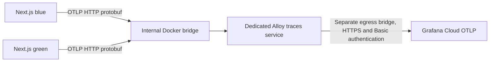

# Backend traces

Backend tracing is implemented and awaits NAS credential setup, deployment, and Grafana verification. It does not change
MongoDB authorization. The normal deployment retains the authorization preflight described in the
[MongoDB metrics guide](MONGODB-METRICS.md).

## Private transport design



Only the two application slots and `traces` join `traces-private`, an `internal: true` Docker bridge. The receiver binds
to its fixed private interface, `172.30.79.2:4318`, and publishes no host ports. Its separate egress interface does not
listen for OTLP. MongoDB, Nginx, and the existing host-network monitoring service do not join this bridge. Docker
administrators and the NAS host remain trusted. This protects against public access and unrelated container access; it
does not protect against a compromised application slot or host administrator.

Check NAS/VPN/Docker routes for conflicts before creation. If necessary, set `OTLP_PRIVATE_SUBNET` and `OTLP_PRIVATE_IP`
together in the NAS `.env` (for example, an unused `/24` and its `.2` address). The same variable sets the application
destination, collector address, and listener. Never set the listener to `0.0.0.0` or publish 4318/4317. The existing
metrics/logging Alloy service remains separate and does not gain an OTLP receiver.

## Credentials and activation

Retrieve the OTLP connection details from the target Grafana Cloud stack. Create an access policy token with the
`traces:write` scope and store these entries only in the NAS deployment `.env`, outside the Git checkout and with
filesystem permissions `0600`:

```dotenv
GC_OTLP_ENDPOINT=https://otlp-gateway-REGION.grafana.net/otlp
GC_OTLP_USER=YOUR_STACK_OTLP_USER
GC_OTLP_TOKEN=YOUR_ACCESS_POLICY_TOKEN
```

Use the HTTPS base endpoint, including `/otlp`; Alloy appends `/v1/traces`. Credentials are supplied only to `traces`
and its networkless validator, never to the application, Docker build arguments, Git, or browser code. Do not paste
resolved Compose configuration, container environment, or tokens into logs or tickets.

The pinned Alloy 1.20.1 image is runtime-tested with the supported top-level Basic authentication attributes. Its
`client_auth` syntax passes configuration validation but fails component startup with no credential source; recheck this
compatibility when upgrading Alloy.

The deployment uploads `docker/monitoring/traces.alloy`, validates it with the pinned Alloy image, and recreates
`traces` before starting the candidate application slot. Compose requires the three Cloud variables. Complete the
existing MongoDB authorization prerequisite before using `pnpm deploy`; that guard also applies to deployment of this
application release. This change has not been deployed to production.

Validation uses a separate `traces-validate` service with `network_mode: none`, so it never claims the running
collector's fixed IP address or starts a receiver.

To validate only the collector configuration on the NAS without reconciling MongoDB or starting the receiver:

```sh
docker compose --env-file .env -f docker/compose.yaml run --rm --no-deps traces-validate
```

Once the infrastructure prerequisite is resolved, follow the normal
[blue/green deployment procedure](../DEVELOPMENT-AND-DEPLOYMENT.md#deployment-and-rollback). Deploy through both slots
to verify both versions; rollback containers retain the release baked into their images.

## Trace context and privacy

`src/instrumentation.ts` initializes a Node-only provider while preserving structured logging. The installed Next.js
16.4.2 guide supports this stable hook and manual SDK setup. Runtime packages are pinned to OpenTelemetry API 1.9.0, SDK
2.8.0, and OTLP exporter 0.219.0. The SDK base and exporter base are direct dependencies because this repository uses
TypeScript `preserveSymlinks`, which otherwise hides inherited dependency types. No MongoDB monkey-patching or automatic
driver instrumentation is enabled.

All exported resources contain only `service.name=rusys-web`, validated `service.version` from the image's
`APP_VERSION`, `deployment.environment.name` from `NODE_ENV`, and `deployment.slot` from `APP_SLOT`. Both Compose slots
set their own slot value. Invalid values become `unknown`. Automatic host, process, command-line, and SDK resource
detection is not enabled.

Application spans cover `products.read`, `products.variants`, `db.groups.find`, `db.products.aggregate`, `image.save`,
`image.classify`, and `image.thumbnail`. Database spans include cursor consumption, so their durations include execution
and data transfer. Product searching/filtering happens inside the product aggregate; no search terms,
product/group/variant names, years, queries, image paths, image contents, user IDs, cookies, or credentials are
recorded.

A final exporter boundary sanitizes automatic Next.js spans as well as custom spans. It replaces arbitrary names with a
static operation/type, permits only enumerated route templates, HTTP methods/status codes and known Next.js span types,
strips all events, links, error messages, instrumentation scope metadata, and W3C tracestate. Trace IDs, span IDs,
parent IDs, timing, span kind, and error status preserve the diagnostic tree. Unknown routes/types become generic
operations; updating routes requires updating this allowlist to retain their labels.

Sampling is nominally 10% by trace ID, including child spans, independent of caller sampling flags. Caller-selected
trace IDs can influence sampling; this is not an ingress rate limit. A bounded 512-span queue batches up to 64 spans
every five seconds; application exports have a three-second transport timeout and four-second batch timeout. Collector
memory, batch size, export queue, and retry time are bounded. Export failure does not fail requests. A natural Node exit
attempts to flush; Next.js owns signal handling and explicitly exits on shutdown, so the last batch can be lost on
restart, SIGTERM, or a crash. No telemetry handler delays application shutdown.

## Validation and Grafana acceptance

```sh
pnpm exec vitest run --project server src/server/telemetry.test.ts scripts/deploy.test.ts
RUN_DOCKER_TESTS=1 pnpm exec vitest run --project server scripts/tracing-network.test.ts
```

The first test sends actual HTTP/protobuf to a local receiver and checks parent/child timing and privacy. The opt-in
Docker test uses disposable internal/egress bridges and the pinned Alloy image; it verifies private reception, refused
egress-interface reception, and no host port bindings. It needs a Docker daemon and cached/pullable
`grafana/alloy:v1.20.1` and `node:26-alpine` images.

After deployment, in Grafana Explore select the traces data source and query:

```traceql
{ resource.service.name = "rusys-web" && resource.deployment.slot = "blue" }
```

Repeat with `green` and check `resource.service.version` against each running image's `APP_VERSION`. Generate repeated
authenticated product loads and image uploads because only 10% of traces are sampled. Open a trace: product read must
contain the group lookup and product aggregate, and a photo upload must show classify/thumbnail work. Compare span
duration to request latency and verify no values from actual products, images, URLs, or exceptions appear. Verify the
collector has no published ports and that public/LAN connections to NAS ports 4317/4318 fail. These live Grafana and NAS
checks remain deployment acceptance steps; local tests do not prove Cloud ingestion.

References: [Next.js instrumentation](https://nextjs.org/docs/app/api-reference/file-conventions/instrumentation),
[Alloy OTLP receiver](https://grafana.com/docs/alloy/latest/reference/components/otelcol/otelcol.receiver.otlp/),
[Alloy HTTP exporter](https://grafana.com/docs/alloy/latest/reference/components/otelcol/otelcol.exporter.otlphttp/).
