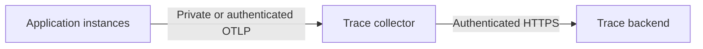

# Backend traces

Backend OpenTelemetry traces connect request latency to product queries, database work, and image processing. The
application exports OTLP traces to a collector, which forwards them to the configured observability backend.
[Monitoring overview](MONITORING.md).

## Transport and credentials



Choose a collector endpoint reachable from the application runtime. Restrict ingestion through private networking or
authenticated transport; do not publish an unauthenticated receiver. Store ingestion credentials in the deployment
platform's secret manager and provide only the collector credentials it needs. Keep them out of source control, build
arguments, browser variables, and diagnostic output.

For Grafana Cloud, configure the collector with its OTLP connection details and a token scoped to `traces:write`:

```dotenv
GC_OTLP_ENDPOINT=https://your-otlp-endpoint.example.com/otlp
GC_OTLP_USER=YOUR_OTLP_USER
GC_OTLP_TOKEN=YOUR_ACCESS_POLICY_TOKEN
```

The endpoint is a base URL; the collector appends `/v1/traces`. Application-side export uses
`OTEL_EXPORTER_OTLP_TRACES_ENDPOINT`, which is the complete trace ingestion URL.

## Application instrumentation

[`src/instrumentation.ts`](../../src/instrumentation.ts) initializes tracing only for the Node.js runtime, preserving
structured logging. [`telemetry.ts`](../../src/server/telemetry.ts) configures an explicit HTTP/protobuf exporter and a
batch processor. Validate hook and SDK APIs against the installed packages when upgrading the framework or tracing SDK.
The provider does not automatically instrument the MongoDB driver or detect host/process resources.

| Resource attribute            | Source                  |
| ----------------------------- | ----------------------- |
| `service.name`                | `rusys-web`             |
| `service.version`             | Validated `APP_VERSION` |
| `deployment.environment.name` | Validated `NODE_ENV`    |
| `deployment.slot`             | Validated `APP_SLOT`    |

Invalid release, environment, or slot values become `unknown`. Configure release identity for every application image or
platform deployment; retain it when restoring a previous release.

Application spans cover `products.read`, `products.variants`, `db.groups.find`, `db.products.aggregate`, `image.save`,
`image.classify`, and `image.thumbnail`. Database spans include cursor consumption. Search and filtering execute inside
the product aggregate.

## Privacy and resource bounds

A final export boundary sanitizes both framework and application spans. Names are static operations or known framework
types. Attributes are limited to enumerated route templates, HTTP methods/status codes, and known span types. Events,
links, error text, arbitrary scope metadata, and W3C tracestate are removed. Trace/span relationships, timings, and
error status preserve the diagnostic tree.

Do not record search terms, product names, database queries, image paths or contents, user IDs, cookies, or credentials.
When adding operations or routes, update the bounded allowlists and privacy tests.

Sampling is nominally 10% by trace ID and ignores caller sampling flags. Caller-selected IDs can influence sampling;
this is not a request rate limit. The application uses a bounded 512-span queue, batches up to 64 spans, and limits
transport/export time. Collector memory, batches, export queues, and retries are also bounded. Export errors do not fail
application requests. Explicit process shutdown or a crash may lose the last batch.

## Supplied container integration

The [Compose configuration](../../docker/compose.yaml) provides a dedicated `traces` service with an internal network
shared only by the application slots and collector. The receiver binds to its configured private interface, publishes no
host ports, and uses a separate network for outbound traffic. Configure `OTLP_PRIVATE_SUBNET` and `OTLP_PRIVATE_IP`
together when adapting network allocation. The application destination and listener must agree.

The collector has a 256 MiB container memory limit, an Alloy memory limiter, and bounded export queues. Choose
additional resource constraints supported by the target runtime. The `traces-validate` service has no network access and
validates configuration without starting a receiver:

```sh
docker compose --env-file .env -f docker/compose.yaml run --rm --no-deps traces-validate
```

For another hosting provider, replace this network and secret injection with its supported collector integration. The
Node.js provider and exporter must be compatible with the chosen runtime; the supplied Compose commands do not deploy to
other platforms. See [deployment targets](../DEVELOPMENT-AND-DEPLOYMENT.md#deployment-targets).

## Verification

```sh
pnpm exec vitest run --project server src/server/telemetry.test.ts scripts/deploy.test.ts
RUN_DOCKER_TESTS=1 pnpm exec vitest run --project server scripts/tracing-network.test.ts
```

Tests cover real HTTP/protobuf export, parent/child timing, privacy filtering, and the container integration's private
network boundaries. They do not establish ingestion by a remote backend.

In the trace backend, query for the service and inspect release/environment attributes:

```traceql
{ resource.service.name = "rusys-web" }
```

Generate representative authenticated product reads, searches, and image uploads, allowing for sampling. Confirm that
request traces contain the relevant nested operations and useful durations, that slot labels distinguish instances where
applicable, and that no sensitive request values are exported. Verify receiver access restrictions separately.

References: [Next.js instrumentation](https://nextjs.org/docs/app/api-reference/file-conventions/instrumentation),
[Alloy OTLP receiver](https://grafana.com/docs/alloy/latest/reference/components/otelcol/otelcol.receiver.otlp/),
[Alloy HTTP exporter](https://grafana.com/docs/alloy/latest/reference/components/otelcol/otelcol.exporter.otlphttp/).
