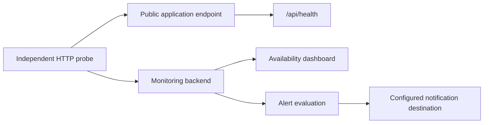

# External availability monitoring

External HTTP checks verify the public application independently of its runtime, database, and telemetry collector. They
can detect failures that application-side instrumentation cannot report. The supplied dashboard targets Grafana Cloud
Synthetic Monitoring; the same checks can be implemented by another external monitoring service.
[Monitoring overview](MONITORING.md).

## Check contract

`GET /api/health` returns HTTP 200, `{"status":"ok"}`, and a `Cache-Control` header containing `no-store`. It is a
liveness endpoint and does not query MongoDB or the collector. Monitor a representative public page separately so a
successful liveness response is not mistaken for complete application readiness.



Configure these checks for the chosen environment:

| Setting                         | Public page                 | Health endpoint                                              |
| ------------------------------- | --------------------------- | ------------------------------------------------------------ |
| Job name for supplied dashboard | `rusys-homepage`            | `rusys-health`                                               |
| Example URL                     | `https://app.example.com/`  | `https://app.example.com/api/health`                         |
| Method                          | `GET`                       | `GET`                                                        |
| Expected status                 | Intended public page status | `200`                                                        |
| Response validation             | Expected page behavior      | Body `^\{"status":"ok"\}$`; cache header includes `no-store` |
| Labels                          | Project and environment     | Project and environment                                      |

Select probe locations, intervals, and timeouts appropriate to the service's availability objectives. For example, a
five-minute interval and ten-second timeout provide a simple starting configuration; these are environment choices, not
application requirements. Use checks from outside the deployment network.

## Credentials

Use the monitoring provider's own configuration workflow and scoped API credentials. For optional local Grafana
administration, keep a private `.env.grafana.local` file with environment-specific values:

```dotenv
GRAFANA_URL=https://your-stack.example.com/
ALERT_EMAIL=alerts@example.com
SM_BACKEND_URL=your-synthetic-monitoring-api.example.com
SM_ACCESS_TOKEN=YOUR_SYNTHETIC_MONITORING_TOKEN
GRAFANA_SERVICE_ACCOUNT_TOKEN=YOUR_GRAFANA_ADMINISTRATION_TOKEN
```

Synthetic Monitoring and Grafana administration use different credentials. Obtain backend addresses and tokens from the
corresponding service, limit permissions to the configuration work required, and keep them out of Git and browser
variables. Application and deployment commands do not automatically load this file. Cloud-hosted probes do not need
these administration tokens installed with the application.

## Alert routing

Define alert conditions using the service's availability objective. A failed-execution threshold counts failures within
a window; it does not necessarily mean consecutive failures. Account for probe count and check interval when selecting
the threshold.

Configure a notification destination and a route matching the check labels. Use stable project, environment, and job
labels so unrelated environments do not notify the wrong destination. Group notifications by service or check to keep
incidents understandable.

Test both the contact integration and the full path from an alert condition to delivered notification. A contact-point
test alone does not verify evaluation or notification routing. Exercise alert conditions using a disposable test check
instead of disrupting the production application, then remove the test resources.

## Dashboard

Import [synthetic-dashboard.json](../../docker/monitoring/synthetic-dashboard.json) into the target Grafana instance and
select its Prometheus data source. Its job filters expect `rusys-homepage` and `rusys-health`; adapt them if check names
differ. The dashboard displays availability, last check time, uptime, response time, and state history.

Use project and environment filters when sharing a monitoring backend across deployments. Historical availability
depends on the check data retained by the provider.

## Verification

Verify the health contract against the environment's public URL:

```sh
curl -si https://app.example.com/api/health
```

Confirm enabled checks produce fresh results, then query the selected data source:

```promql
probe_success{job=~"rusys-homepage|rusys-health"}
probe_http_status_code{job=~"rusys-homepage|rusys-health"}
probe_duration_seconds{job=~"rusys-homepage|rusys-health"}
```

Expect successful probes, intended HTTP statuses, and plausible durations. Confirm dashboard filters, alert evaluation,
and notification delivery independently. These checks do not require a container collector or a particular hosting
provider.

References:
[Grafana HTTP checks](https://grafana.com/docs/grafana-cloud/observe-and-act/testing/synthetic-monitoring/create-checks/checks/http/),
[Synthetic Monitoring authentication](https://grafana.com/docs/grafana-cloud/observe-and-act/testing/synthetic-monitoring/api-reference/),
[Grafana service accounts](https://grafana.com/docs/grafana/latest/administration/service-accounts/).
