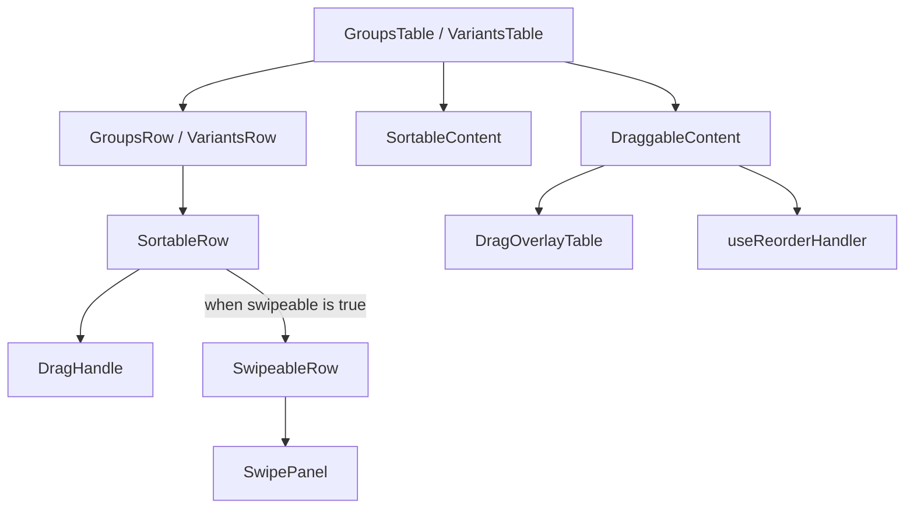

# Table components

This guide describes the current row sorting and swipe infrastructure.

## Component relationships

`GroupsTable` and `VariantsTable` use Mantine `Table`, `@dnd-kit` sorting, and `useReorderHandler`. Their rows pass
`swipeable={false}`: users can drag a row by its handle or open editing by clicking the row, but swipe controls are
disabled. `Enter` and Space also open editing. Clicks on the drag handle are ignored by the edit handler.

## Row sorting

- `DraggableContent` creates the `DndContext`. Its pointer sensor activates after 8 px of movement; its keyboard sensor
  uses `sortableKeyboardCoordinates`. Dragging is restricted to the vertical axis and the parent element.
- `SortableContent` applies `verticalListSortingStrategy`. `SortableRow` connects each row to `useSortable` and passes
  sensor and accessibility attributes to `DragHandle`.
- `DragOverlayTable` renders a copy of the dragged row with the original column widths.
- `useReorderHandler` temporarily freezes the reordered item list while `onReorder` saves it. This prevents rows from
  jumping while the server responds.
- Group and variant tables disable dragging when a quick filter is active or the row is hidden.

## Swipeable row infrastructure

`SortableRow` uses `SwipeableRow` by default, but the current group and variant tables turn this option off.
`SwipeableRow` attaches native `pointerdown`, `pointermove`, `pointerup`, `pointercancel`, and `pointerleave` listeners
to a Mantine `Table.Tr`.

1. A swipe starts when horizontal movement reaches `POINTER_MOVE_THRESHOLD` (currently 10 px) and exceeds vertical
   movement. Gestures starting on `[data-drag-handle]` are excluded.
2. Once a swipe is confirmed, the row captures pointer events. The controls panel follows the pointer through direct DOM
   updates without waiting for a React render on every move.
3. On release, the panel opens or closes according to direction and a threshold of 20% of the measured controls width.
   The table uses `touch-action: pan-y` when the panel is closed and `touch-action: none` when it is open.

`ActiveContentContext` and `SwipeControlsContext` hold the active row and panel state. `SwipePanel` renders through a
Mantine `Portal`, and `useSwipeVisible` controls page scrolling while the panel is open. `SwipeableRow` does not
implement a long-press action.

## Where to change behavior

| Concern                      | File                                                                             |
| ---------------------------- | -------------------------------------------------------------------------------- |
| Drag sensors and constraints | `src/components/common/DraggableContent.tsx`                                     |
| Sortable row and drag handle | `src/components/table/SortableRow.tsx`, `DragHandle.tsx`                         |
| Swipe recognition            | `src/components/table/SwipeableRow.tsx`                                          |
| Pointer movement threshold   | `src/lib/utils/pointer.ts`                                                       |
| Controls panel and its width | `src/components/common/SwipePanel.tsx`                                           |
| Reorder state                | `src/components/hooks/useReorderHandler.ts`                                      |
| Current table usage          | `src/features/groups/GroupsTable.tsx`, `src/features/variants/VariantsTable.tsx` |
